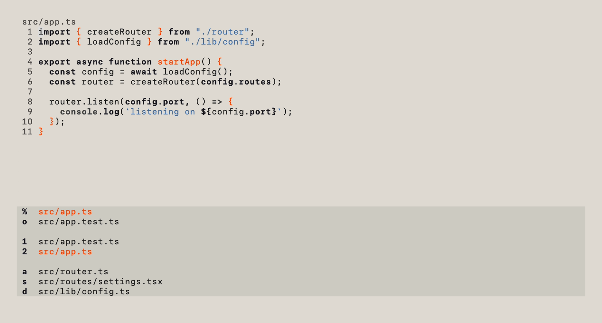
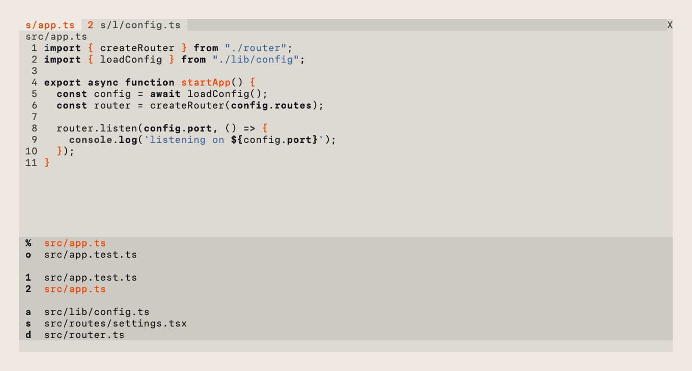
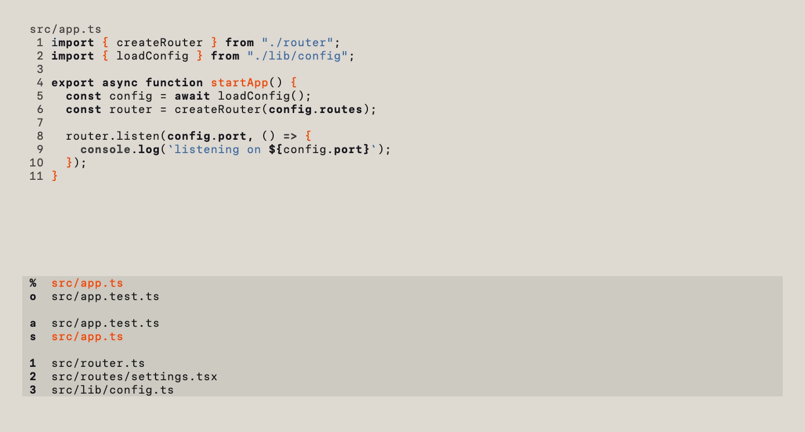

# radar.nvim

> Jump between your working files with two keystrokes.

radar.nvim shows the file you're in, its alternative, your locks and recent files at the bottom of your pane, each one keystroke after `<space>`.



## Concept

`radar.nvim` provides **instant access** to your working files through spatial keyboard shortcuts, eliminating the need for fuzzy finders or file trees for your active working set.

- **File Pinning**: Lock your most important files to the home row keys a-g for instant access
- **Smart Persistence**: Context-aware storage per project and git branch
- **Prefix Keys**: `<space>` plus one key jumps to a lock, a recent file or the alternative file
- **Lock HUD**: A small always-visible window at the bottom of the active pane with the current and alternative file, the first locks and recent files
- **Tab HUD**: All open tabs and their buffers, where the Lock HUD sits
- **Dynamic Highlighting**: Auto-highlight the currently active locked file

See also [Concept](./docs/concept.md)

**Keybindings**

```
<space> then:
[a][s][d][f][g]  ← Locks (files you lock)
[1][2][3][4][5]  ← Recent files (per project and branch)
[o]              ← Alternative file (test ↔ impl)
```

This spatial keyboard layout gives you instant access to **15 files** without moving your left hand from home position.

## Installation

### Using [lazy.nvim](https://github.com/folke/lazy.nvim)

```lua
{
  "black-atom-industries/radar.nvim",
  opts = {}
}
```

### Configuration Examples

**Choose the prefix:**

Every jump starts with the prefix, `<space>` by default. My leader is `,`, so `<space>` is free for radar.nvim. If your leader is `<space>`, turn it around and give radar.nvim the key you don't use as leader. Sharing one key makes Neovim wait `timeoutlen` after each press to tell a radar.nvim key from a leader mapping.

```lua
-- vim.g.mapleader = " "
{
  "black-atom-industries/radar.nvim",
  opts = {
    keys = {
      prefix = ",",  -- then ,1 jumps to lock 1, ,o to the alternative file
    },
  }
}
```

**Simple customization:**

```lua
{
  "black-atom-industries/radar.nvim",
  opts = {
    hud = {
      max_locks = 9,
      max_recent = 5,
    },
    recent = {
      max_files = 20,
    },
  }
}
```

**Customize Tab HUD:**

```lua
{
  "black-atom-industries/radar.nvim",
  opts = {
    keys = {
      tabs_toggle = "<leader>b",  -- default: "<leader>t"
    },
    tabs = {
      auto_close = false,  -- keep open after selecting
    }
  }
}
```

## Configuration Reference

For full type definitions see [`config.types.lua`](lua/radar/config.types.lua). For all defaults see [`config.lua`](lua/radar/config.lua).

| Option                                              | Default                               | Description                                                                     |
| --------------------------------------------------- | ------------------------------------- | ------------------------------------------------------------------------------- |
| `keys.prefix`                                       | `"<space>"`                           | Prefix that reads one more key                                                  |
| `keys.lock`                                         | `"l"`                                 | Lock current buffer to a slot                                                   |
| `keys.locks`                                        | `{"a","s","d","f","g"}`               | Keys for lock slots                                                             |
| `keys.recent`                                       | `{"1".."5"}`                          | Keys for recent file slots                                                      |
| `keys.tabs_toggle`                                  | `"<leader>t"`                         | Toggle Tab HUD                                                                  |
| `keys.alternative`                                  | `"o"`                                 | Alternative file (after the prefix)                                             |
| `keys.hud_toggle`                                   | `"h"`                                 | Toggle the Lock HUD for the session (after the prefix)                          |
| `keys.tabs`                                         | `"t"`                                 | Toggle the Tab HUD (after the prefix)                                           |
| `keys.edit`                                         | `"e"`                                 | Open the lock editor (after the prefix)                                         |
| `keys.help`                                         | `"?"`                                 | Show the keys that follow the prefix (after the prefix)                         |
| `recent.max_files`                                  | `10`                                  | Recent files kept per project and branch                                        |
| `hud.enabled`                                       | `true`                                | Show the Lock HUD                                                               |
| `hud.dodge`                                         | `true`                                | Move the Lock HUD to the top of the pane while the cursor line runs under it    |
| `hud.max_locks`                                     | `5`                                   | Locks shown in the Lock HUD                                                     |
| `hud.max_recent`                                    | `3`                                   | Recent files shown in the Lock HUD                                              |
| `tabs.auto_close`                                   | `true`                                | Close tabs window after selecting                                               |
| `file_float.win_preset`                             | `"center_narrow"`                     | Window preset for the floating file view (`<C-f>` in the lock editor)           |
| `persist.path`                                      | `stdpath("data")/radar/data.json`     | Persistence file location                                                       |
| `persist.defer_ms`                                  | `500`                                 | Debounce delay for saves                                                        |
| `win_presets`                                       | `{}`                                  | Override or add custom window presets                                           |

**Available window presets** (for `win_preset` fields): `"cursor"`, `"center"`, `"center_large"`, `"center_narrow"`, `"top_left"`, `"top_right"`, `"bottom_left"`, `"bottom_right"`, `"bottom_center"`, `"full_height_sidebar"`

## Usage

### Default Keybindings

**Global:**

`<space>` waits for one more key:

- **`a s d f g`**: Jump to a lock
- **`1-5`**: Jump to a recent file
- **`o`**: Open the alternative file
- **`l`**: Lock or unlock the current buffer
- **`h`**: Toggle the Lock HUD for this session
- **`t`**: Toggle the Tab HUD
- **`e`**: Open the lock editor
- **`?`**: Show these keys
- **`<Esc>`** or any other key: Cancel

- **`<leader>t`**: Toggle Tab HUD

**Lock HUD:**

The Lock HUD sits at the bottom of the active pane, as wide as the pane, and follows you between splits. It shows the file you are in (`%`, highlighted), the alternative file, up to 5 locks and 3 recent files with the keys that reach them after `<space>`. A locked current file is highlighted; the current file never takes a recent slot. It moves to the top of the pane while your cursor line runs under it and hides while the Tab HUD or the lock editor is open and when there is nothing to show.

To keep the Lock HUD at the bottom instead, set `hud = { dodge = false }` and raise `scrolloff` to at least the Lock HUD's height, so the cursor never reaches its rows. On Neovim nightly, `scrolloffpad` keeps that padding at the end of a file too:

```lua
vim.o.scrolloff = 11      -- the HUD at its tallest: 5 locks, 3 recent files
vim.o.scrolloffpad = 99   -- Neovim nightly
require("radar").setup({ hud = { dodge = false } })
```


**Lock editor:**

`<space>e` opens the lock editor where the Lock HUD sits: at the bottom of the active pane, as wide as the pane. One lock path per line; the line order sets the labels. `:w` saves, `q` saves and closes. `<CR>`, `<C-v>`, `<C-s>`, `<C-t>` and `<C-f>` save and open the file under the cursor in the current window, a vertical split, a horizontal split, a new tab or a floating window.


**Tab HUD:**

`<space>t` (or `<leader>t`) opens the Tab HUD where the Lock HUD sits: every tab with its number and the buffers shown in it, the current tab and buffer in the accent color.



- **`<CR>`**: Jump to tab/buffer
- **`1-9`**: Jump to that tab
- **`x`**: Close buffer or tab
- **`q` / `<Esc>`**: Close Tab HUD

### Context-Aware Persistence

Locks and recent files are saved and restored per project and git branch, so switching between projects or branches maintains separate lock sets and file histories.

- The project is the git root containing the working directory (the worktree root inside a worktree), or the working directory outside git.
- Lock and recent file paths are stored relative to the project root.
- Recent files list this session's files first, then the saved history (up to `recent.max_files`), then `vim.v.oldfiles`. Missing files are dropped on load.
- Detached HEAD and non-git directories keep locks and recent files in memory only, until you switch to another project.
- A corrupt data file is moved to `data.json.bad`. Writes are atomic.

### Data Cleanup

Over time, your persistence data file can accumulate entries for deleted branches or old projects. Use the cleanup command to remove stale entries:

```vim
:RadarCleanup          " Remove entries for branches that no longer exist
:RadarCleanup --dry-run  " Preview what would be deleted without making changes
```

**What gets cleaned:**

- Entries for projects whose directories no longer exist
- Entries for git branches that have been deleted
- Current branch is always preserved (fail-safe)

**From Lua:**

```lua
require("radar").cleanup()                    -- Remove stale entries
require("radar").cleanup({ dry_run = true })  -- Preview only
```

## Testing

This plugin includes tests using [mini.test](https://github.com/echasnovski/mini.test) with busted-style syntax.

### Available Commands

### Development Dependencies

Some `make` targets require additional tools. Install them with:

| Tool | Purpose | Install |
|---|---|---|
| **StyLua** | Lua formatter | `brew install stylua` or `mise install stylua` |
| **lua-language-server** | Type checking | `brew install lua-language-server` or `mise install lua-language-server` |
| **Selene** | Lua linter | `cargo install selene` |
| **entr** | Test watch mode | `brew install entr` |

If you use [mise](https://mise.jdx.dev), run `mise install` to install `lua-language-server` and `stylua` automatically.

### Available Commands

| Command             | Description                     | Dependencies                              |
| ------------------- | ------------------------------- | ----------------------------------------- |
| `make test`                                         | Run all tests                         | None                                                                            |
| `make test-verbose`                                 | Run tests with verbose output         | None                                                                            |
| `make test-watch`                                   | Watch for changes and run tests       | `entr` (`brew install entr`)                                                    |
| `make validate`                                     | Validate test setup                   | None                                                                            |
| `make check`                                        | Run all linters and type checks       | `stylua`, `lua-language-server`, `selene`                                       |
| `make lint`                                         | Check Lua formatting                  | `stylua` (`brew install stylua`)                                                |
| `make typecheck`                                    | Run type checking                     | `lua-language-server`                                                           |
| `make selene`                                       | Run selene linter                     | `selene` (`cargo install selene`)                                               |
| `make format`                                       | Format Lua files                      | `stylua` (`brew install stylua`)                                                |
| `make install-hooks`                                | Enable pre-commit hooks               | None                                                                            |
| `make clean`                                        | Clean test artifacts                  | None                                                                            |
| `make help`                                         | Show all available commands           | None                                                                            |

### Writing Tests

Tests are located in `test/spec/` and use mini.test with busted emulation:

```lua
describe("my feature", function()
  it("should work correctly", function()
    MiniTest.expect.equality(result, expected)
  end)
end)
```

## Interface Preview

The Lock HUD at the bottom of the active pane: the current file, the alternative file, locks and recent files, each with the key that reaches it after `<space>`.



## Learn More

- [docs/concept.md](docs/concept.md) - Comprehensive design vision and philosophy
- [AGENTS.md](AGENTS.md) - Technical architecture and development patterns

## License

MIT
